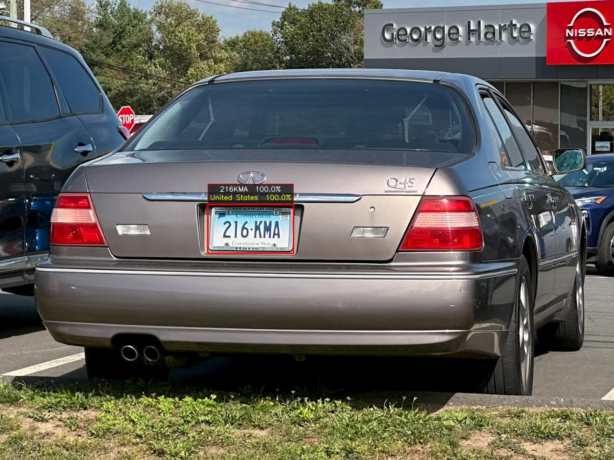
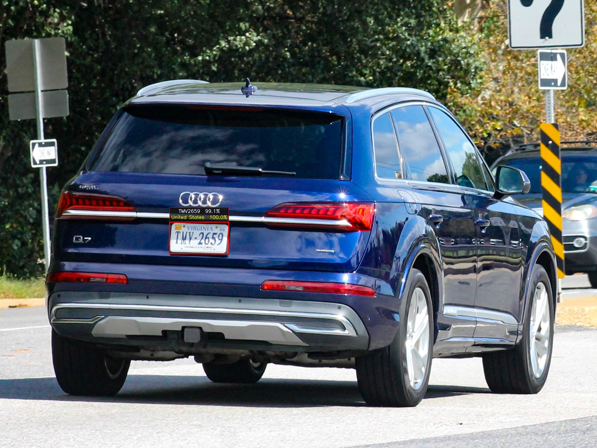
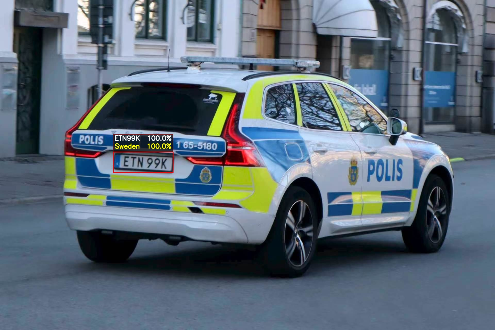
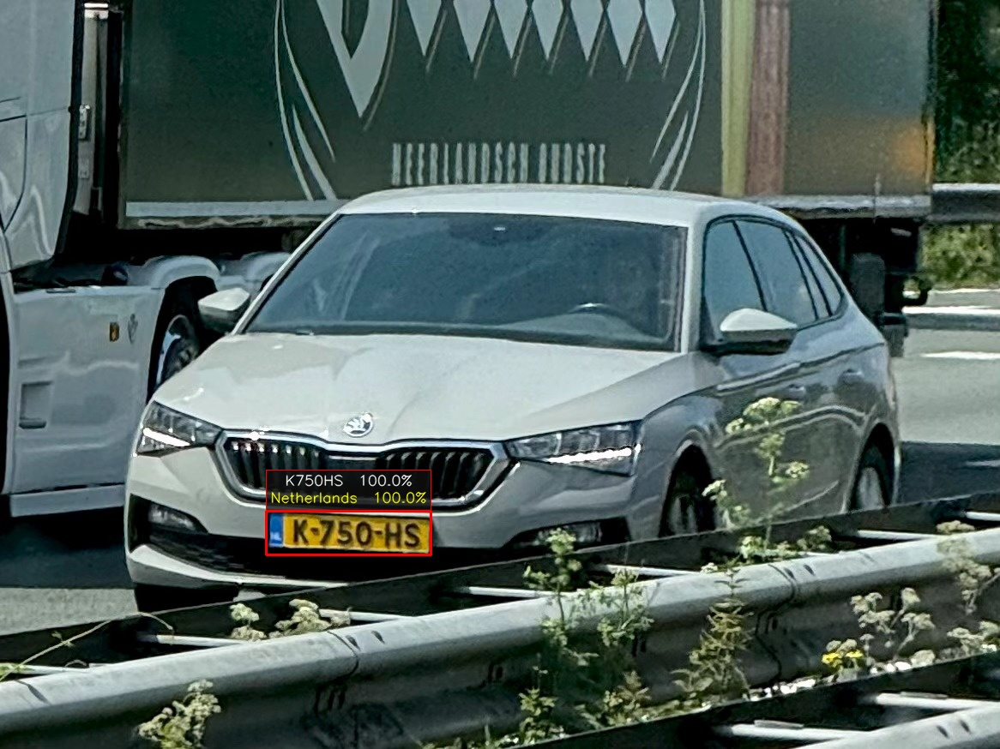

[简体中文](./README.md) | [繁體中文](./README_zh.md) | English | [한국어](./README_ko.md)

If you find this project useful, please consider giving it a Star ⭐️🌟. Thank you!

# Acknowledgments & Contact
### 1. WeChat ID: cbp931126   
1. Join the discussion group (include `PlateAlgorithm` in your request). There are many experienced developers actively sharing and learning;
2. Add the WeChat account to obtain a curated collection of open-source and selected private license plate detection and recognition datasets (a fee of CNY 30 is required for the data);

### 2. Email: cbp931126@163.com

# Web Test
## 1. Try online recognition for Mainland Chinese, Hong Kong, Macao, and Taiwan license plates: http://vision.zhoujiayao.com/

## 2. Countries and Regions Supported by License Plate Recognition
### Asia
Mainland China, Hong Kong, Macao, Taiwan, South Korea, Japan, Singapore, Thailand, Malaysia, Indonesia, Vietnam, Turkey, Israel, Qatar, Bahrain, Cambodia, Georgia, Armenia, Azerbaijan

### Europe
United Kingdom, France, Germany, Italy, Spain, Switzerland, Netherlands, Austria, Belgium, Portugal, Greece, Ireland, Sweden, Norway, Denmark, Finland, Poland, Czech Republic, Hungary, Romania, Croatia, Iceland, Luxembourg, Cyprus, Malta, Bulgaria, Slovakia, Slovenia, Estonia, Lithuania, Latvia, Ukraine, Serbia, Montenegro, Albania, Bosnia and Herzegovina, North Macedonia, Moldova, Belarus, Andorra, Monaco, Liechtenstein, San Marino, Gibraltar, Guernsey

### North America
United States, Canada, Mexico

### South America
Brazil, Argentina

### Oceania
Australia, New Zealand

## Features
1. Supports license plate recognition, plate color recognition, vehicle distance estimation, and lane line detection
2. Supports vehicle type, vehicle color, front/rear view, and parking space recognition
3. Supports CPU and GPU deployment on Linux, Windows, CentOS, Ubuntu, UnionTech UOS, and Kylin, as well as custom development
4. Provides APIs for C/C++, Python, C#, Java, and other languages
5. Supports deployment on Android, iOS, and HarmonyOS. A commercial test demo is available (WeChat ID: cbp931126)

   | Model | Speed | Accuracy | API | Test OS | Image Size |
   |:----------:|:----------:|:----------:|:----------:|:----------:|:----------:|
   | Redmi K30 Pro (Snapdragon 865) | ~70 ms (CPU/4 cores), ~40 ms (GPU) | 99%+ | Kotlin, Java | Android | 1920*1080 |
   | Redmi K60 (Snapdragon 8+ Gen 1) | ~50 ms (CPU/3 cores), ~30 ms (GPU), ~18 ms (NPU) | 99%+ | Kotlin, Java | Android | 1920*1080 |
   | Redmi K90 MAX (Dimensity 9500) | ~40 ms (CPU/4 cores), ~28 ms (GPU), ~15 ms (NPU) | 99%+ | Kotlin, Java | Android | 1920*1080 |
   | HUAWEI Mate 80 (Kirin 9020) | ~40 ms (CPU/4 cores), ~20 ms (NPU) | 99%+ | ArkTS | HarmonyOS 6.0 | 1920*1080 |
   | iPhone 13 (A15) | ~50 ms (CPU/2 cores), ~13 ms (NPU) | 99%+ | Swift, Objective-C | iOS | 1920*1080 |
   | iPad Air 3 (A12) | ~100 ms (CPU/2 cores), ~35 ms (NPU) | 99%+ | Swift, Objective-C | iOS | 1920*1080 |
   | UNISOC P7885 | ~60 ms/100 ms (GPU/CPU) | 99%+ | Kotlin, Java | Android | 1920*1080 |
6. Supports edge deployment on Rockchip RV1106/RV1126/RK3588/RK3568/RK3576 and other platforms. A commercial test demo is available (WeChat ID: cbp931126)

   | Model | Speed | Accuracy | API | Test OS | Image Size |
   |:----------:|:----------:|:----------:|:----------:|:----------:|:----------:|
   | RK3588 | ~25 ms | 99%+ | C/C++, Python | Ubuntu, Buildroot, Debian, Android | 1920*1080 |
   | RK3576 | ~25 ms | 99%+ | C/C++, Python | Ubuntu, Buildroot, Debian, Android | 1920*1080 |
   | RK3568 | ~70 ms | 99%+ | C/C++, Python | Ubuntu, Buildroot, Debian, Android | 1920*1080 |
   | RV1126B | ~25 ms | 99%+ | C/C++ | Ubuntu, Buildroot, Debian, Android | 1920*1080 |
   | RV1126 | ~62 ms | 99%+ | C/C++ | Ubuntu, Buildroot | 1920*1080 |
   | RV1106 | ~150 ms | 99%+ | C/C++ | Buildroot | 1920*1080 |
7. Supports edge deployment on HiSilicon SS928/Hi3403/Hi3519DV500/Hi3516DV500/Hi3516DV300/Hi3516CV610 and other platforms. A commercial test demo is available (WeChat ID: cbp931126)

   | Model | Speed | Accuracy | API | Test OS | Image Size |
   |:----------:|:----------:|:----------:|:----------:|:----------:|:----------:|
   | SS928/Hi3403 | ~40 ms | 99%+ | C/C++ | Ubuntu, BusyBox | 1920*1080 |
   | Hi3519DV500 | ~50 ms | 99%+ | C/C++ | BusyBox | 1920*1080 |
   | Hi3516CV610 | ~150 ms | 99%+ | C/C++ | BusyBox | 1920*1080 |
8. Supports edge deployment on the Sophgo BM1684 series
9. Supports edge deployment on Axera platforms

## Recognition Results

### US License Plate Recognition
 

### EU License Plate Recognition
 

### Lane Line + Vehicle Distance + License Plate Recognition
 
 

### Korean License Plate Recognition
 
 

### Taiwan License Plate Recognition
 
 

### Hong Kong and Macao License Plate Recognition
 
 

### Mainland Chinese License Plate Recognition
 
 
 
 
 
 

# PlateAlgorithm
## **License Plate Recognition Algorithm Supporting 11 Types of Chinese License Plates**
**1. Single-line blue plate**  
**2. Single-line yellow plate**  
**3. New energy vehicle plate**  
**4. White police vehicle plate**  
**5. Driving school vehicle plate**  
**6. Armed police vehicle plate**  
**7. Double-line yellow plate**  
**8. Double-line armed police vehicle plate**  
**9. Embassy vehicle plate**  
**10. Hong Kong and Macao vehicle plate**  
**11. Double-line agricultural vehicle plate**

## Description
1. License plate detection (yolov5plate, yolov7plate, yolov8plate), plate rectification, plate recognition, and integrated plate detection and recognition;

   | Folder | State | Description |
   |:----------|:----------|:----------|
   | PLateDetection_yolov5 | Done | YOLOv5 license plate detection |
   | PLateDetection_yolov7 | Done | YOLOv7 license plate detection |
   | PLateDetection_yolov8 | Doing | YOLOv8 license plate detection |
   | PlateRecognition | Done | License plate recognition |
   | PlateDetectionRecognition | Done | License plate detection -> plate rectification -> plate recognition |

2. All models use C++ and TensorRT for accelerated inference. The pre-processing and post-processing of yolov7plate are accelerated with CUDA (the approach can also serve as a reference for optimizing other models);
3. A matching engine is generated automatically for each GPU model. If the folder contains an engine built for another GPU, delete it so that an engine for the current GPU can be generated;
4. Conditional compilation options in `PlateDetectionRecognition/test/main.cpp`:

   | Test Type | enable | Description |
   |:----------|:----------|:----------|
   | yolov5_plate | 1 | YOLOv7 license plate detection |
   | yolov7_plate | 1 | YOLOv5 license plate detection |

5. License plate recognition accuracy (test set: 72,000 images)

   | Model | Size | Accuracy | Speed | Platform |
   |:----------:|:----------:|:----------:|:----------:|:----------:|
   | plate_recognition_color | s | 92.40% | 452.480 us | RTX 3090 |
   | plate_recognition_s | s | 98.90% | 452.597 us | RTX 3090 |
   | plate_recognition_m | m | 99.35% | 463.316 us | RTX 3090 |
   | plate_recognition_l | l | 99.56% | 507.082 us | RTX 3090 |

## Algorithm Description

# API
```cpp
/**
 * @brief                  Initializes the license plate module
 * @param config           Module configuration structure
 * @return                 HZFLAG
 */
void*Initialize(Config*config);

/**
 * @brief                  License plate detection and recognition (YOLOv5)
 * @param img              Plate_ImageData
 * @param PlateDet         List of license plate detection and recognition results
 * @return                 HZFLAG
 */
int PlateRecognition_yolov5(void*p,Plate_ImageData*img,PlateDet*PlateDets);

/**
 * @brief                  License plate detection (yolov7_plate)
 * @param img              Plate_ImageData
 * @param PlateDet         List of license plate detection and recognition results
 * @return                 HZFLAG
 */
int PlateRecognition_yolov7(void*p,Plate_ImageData*img,PlateDet*PlateDets);

/**
 * @brief                  License plate detection (yolov8_plate)
 * @param img              Plate_ImageData
 * @param PlateDet         List of license plate detection and recognition results
 * @return                 HZFLAG
 */
int PlateRecognition_yolov8(void*p,Plate_ImageData*img,PlateDet*PlateDets);

/**
 * @brief                  Releases the module
 * @return                 HZFLAG
 */
int Release(void*p,Config*config);
```

## 2. Environment
1. Ubuntu 20.04 + CUDA 11.1 + cuDNN 8.2.1 + TensorRT 8.2.5.1 (tested)
2. Ubuntu 18.04 + CUDA 10.2 + cuDNN 8.2.1 + TensorRT 8.2.5.1 (tested)
3. Windows 10 + CUDA 11.1 + cuDNN 8.2.1 + TensorRT 8.2.5.1 (tested)
4. For other environments, try the setup yourself or join the discussion group for more information

## 3. Build
1. Edit `CMakeLists.txt` in the project root and set the TensorRT installation directory:
```cmake
set(TensorRT_INCLUDE "/xxx/xxx/TensorRT-8.2.5.1/include" CACHE INTERNAL "TensorRT Library include location")
set(TensorRT_LIB "/xxx/xxx/TensorRT-8.2.5.1/lib" CACHE INTERNAL "TensorRT Library lib location")
```
2. OpenCV, CUDA, and cuDNN are assumed to be installed
3. The project is built with `-g O0` by default for debugging. Build the Release configuration for better performance
4. Build with the Visual Studio Code shortcut (choose either step 4 or 5):
```
ctrl+shift+B
```
5. Build from the command line (choose either step 4 or 5):
```bash
mkdir build
cd build
cmake ..
make -j6
```

# References
1. https://github.com/deepcam-cn/yolov5-face
2. https://github.com/derronqi/yolov7-face/tree/main
3. https://github.com/derronqi/yolov8-face
